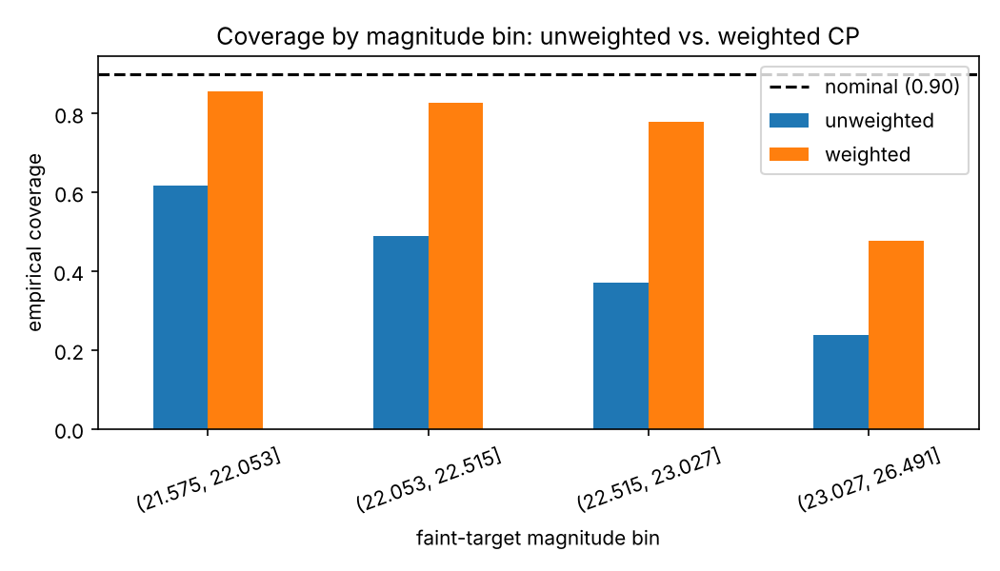

# Photometric Redshift Regression with Conformal Prediction

A measured result about uncertainty under a selection effect: does conformal prediction's
coverage guarantee survive a magnitude-selected covariate shift, and if not, does weighted
conformal prediction (Tibshirani et al., 2019) fix it?

## Result (run end-to-end against real data, not synthetic)

| method | coverage (nominal 0.90) | mean interval width |
|---|---|---|
| unweighted split conformal | **0.429** | 0.740 |
| weighted conformal | **0.735** | 1.220 |

Coverage by faint-target magnitude bin (brightest quartile of the faint set -> faintest):

| mag_F160W bin | unweighted | weighted |
|---|---|---|
| (21.57, 22.05] | 0.618 | 0.857 |
| (22.05, 22.52] | 0.490 | 0.827 |
| (22.52, 23.03] | 0.371 | 0.778 |
| (23.03, 26.49] | 0.238 | 0.478 |



Domain classifier (bright-calibration vs. faint-target) AUC: **0.9999**. Effective calibration
sample size after reweighting: **48.3 of 596** calibration points.

**Reading it:**
1. Unweighted split conformal fails exactly as predicted: coverage collapses from a nominal 90%
   to 43% on the faint target, and worsens monotonically with magnitude.
2. Weighted conformal recovers most of it (74%), at a real cost: intervals are ~65% wider.
3. The correction has a hard limit: the faintest quartile stays well under nominal. The domain
   classifier is near-perfectly separable (AUC ~1.0) because the bright/faint split is a hard
   threshold on a feature (`mag_F160W`) the classifier can see directly, which collapses the
   effective calibration sample size to ~8% of its nominal size -- a few bright objects end up
   carrying almost all the reweighted calibration mass. There's no bright analog for the
   faintest faint objects, so no amount of reweighting the *existing* calibration set recovers
   coverage there.


## Data and a naming note

Data is the [3D-HST](https://archive.stsci.edu/prepds/3d-hst/) master photometric catalog
(Skelton et al., 2014; Brammer et al., 2012): ~208k sources across 5 CANDELS fields, with both
spectroscopic (`z_spec`) and EAZY template-fit photometric (`z_peak`) redshifts. A cleaned
parquet (`data/raw/3dhst_master_clean.parquet`) is included directly, with these cuts already
applied: `use_phot==1`, `z_spec>0`, `lmass>9` (standard quality cuts for this catalog -- a
mass-complete sample with a reliable redshift). That leaves **3,971** sources with real
spectroscopic redshifts (this catalog is photometric-first; only a small cross-matched subset
has spectroscopy at all -- see caveat below).

This survey has 5 HST bands (F606W, F814W, F125W, F140W, F160W), not SDSS's *ugriz*, so there's
no literal "r" magnitude. `F160W` is this catalog's own reference/detection band, so
**`mag_F160W` stands in for "r"** throughout: it's the variable the bright/faint split is made on, and it is itself one of the model's input features (so the selection depends only on
observed inputs, which is what makes the covariate shift clean by construction).

## Notebooks

Run in order; each saves its output to `data/processed/` for the next.

| Notebook | What it does |
|---|---|
| `00_environment_check.ipynb` | Confirms required packages are installed. |
| `01_data_acquisition.ipynb` | Loads the pre-cleaned 3D-HST parquet; sanity checks. |
| `02_feature_engineering.ipynb` | Fluxes -> AB magnitudes, all pairwise colors, median-impute missing bands. |
| `03_bright_faint_split_and_baseline_model.ipynb` | Splits on `mag_F160W` median; plain XGBoost trained on bright-train only. |
| `04_unweighted_conformal.ipynb` | Split conformal calibrated on bright, applied to faint -- the failure case. |
| `05_weighted_conformal.ipynb` | Domain-classifier weights, weighted quantile, effective sample size, 99th-percentile weight clipping. |
| `06_evaluation_summary.ipynb` | The comparison table and figure above. |

## Extensions / next steps

**Closing the gap in the faintest bin**
- Re-estimate the domain classifier with cross-validated (out-of-fold) weights instead of fitting and scoring on the same data -- the current AUC of 0.9999 is partly inflated by that overlap.
- Try a less feature-complete domain classifier (e.g. drop `mag_F160W` itself and only give it colors) to see how much of the near-perfect separability is the hard threshold vs. genuine distributional difference -- this would also test whether the covariate-shift story holds for a *softer* selection, not just the clean constructed one.
- Pool several magnitude thresholds (not just the median) and show coverage/width/`n_eff` as a continuous function of how far the target distribution sits from calibration -- right now it's one bright/faint cut.

**Other conformal variants (natural next layer, not implemented here)**
- Mondrian CP: stratify calibration by object type or magnitude bin instead of reweighting -- compare its conditional coverage to weighted CP's.
- Normalized (locally-weighted) CP: a second regressor predicting `|residual|` as a per-object difficulty score, scaling interval width before any reweighting.
- CQR: quantile regressors at `alpha/2` / `1-alpha/2`, conformalized -- likely to handle the one-sided catastrophic-outlier tail better than the symmetric score used here.

**Data and modeling**
- Bring in EAZY's own per-object `l95`/`u95` intervals (in the per-field `*.zout` files) as a template-fitting baseline to compare against both conformal methods -- left out here because it needs a field+id join.
- Replace the global-median flux imputation with a fold-aware imputer (fit on train, applied to calibration/target) to remove the one acknowledged leakage simplification.
- Basic hyperparameter tuning of the XGBoost point model -- it's deliberately left at fixed defaults here since point accuracy isn't the thing being measured.

**Statistical rigor**
- Bootstrap the coverage numbers themselves (both overall and per-bin) to get a confidence interval on coverage -- at ~600-2,000 points per group, a single coverage estimate has real sampling noise that isn't currently reported.

## Environment

```bash
python -m venv .venv
source .venv/bin/activate
pip install -r requirements.txt
jupyter notebook notebooks/
```

## References

Brammer, G. B., et al. (2012). 3D-HST: A wide-field grism spectroscopic survey with the Hubble
Space Telescope. *The Astrophysical Journal Supplement Series, 200*(2), 13.

Skelton, R. E., et al. (2014). 3D-HST WFC3-selected photometric catalogs in the five CANDELS/3D-HST
fields: Photometry, photometric redshifts, and stellar masses. *The Astrophysical Journal
Supplement Series, 214*(2), 24.

Tibshirani, R. J., Barber, R. F., Candès, E. J., & Ramdas, A. (2019). Conformal prediction under
covariate shift. *arXiv preprint*. https://arxiv.org/abs/1904.06019
